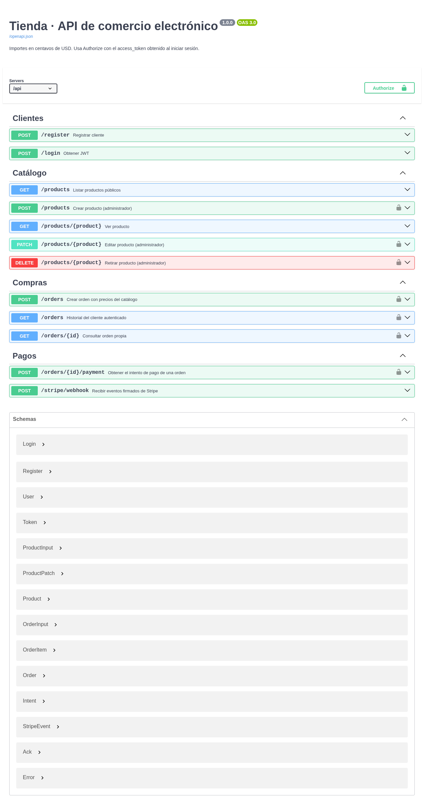
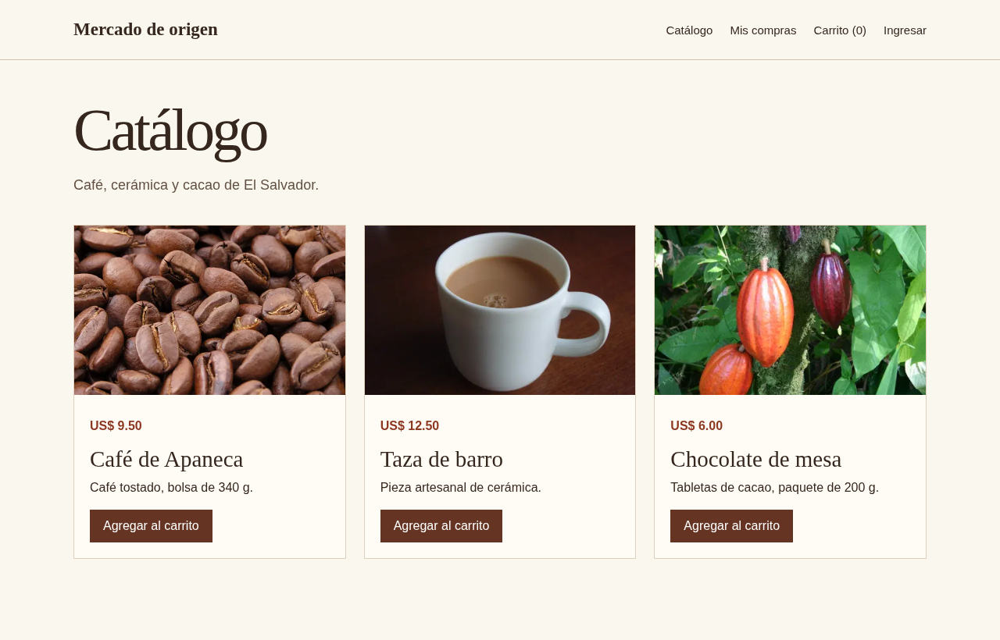
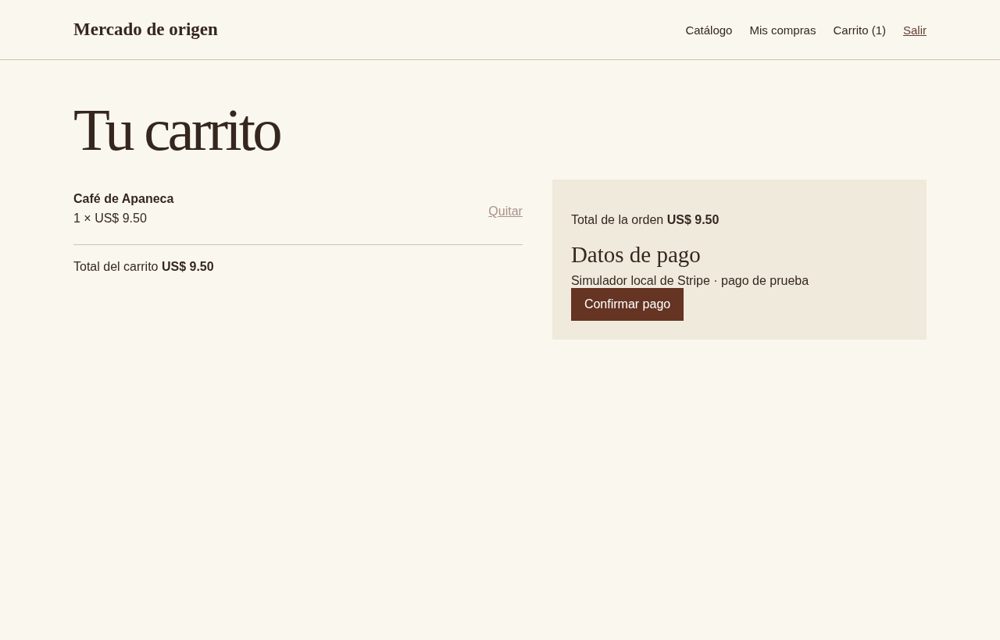
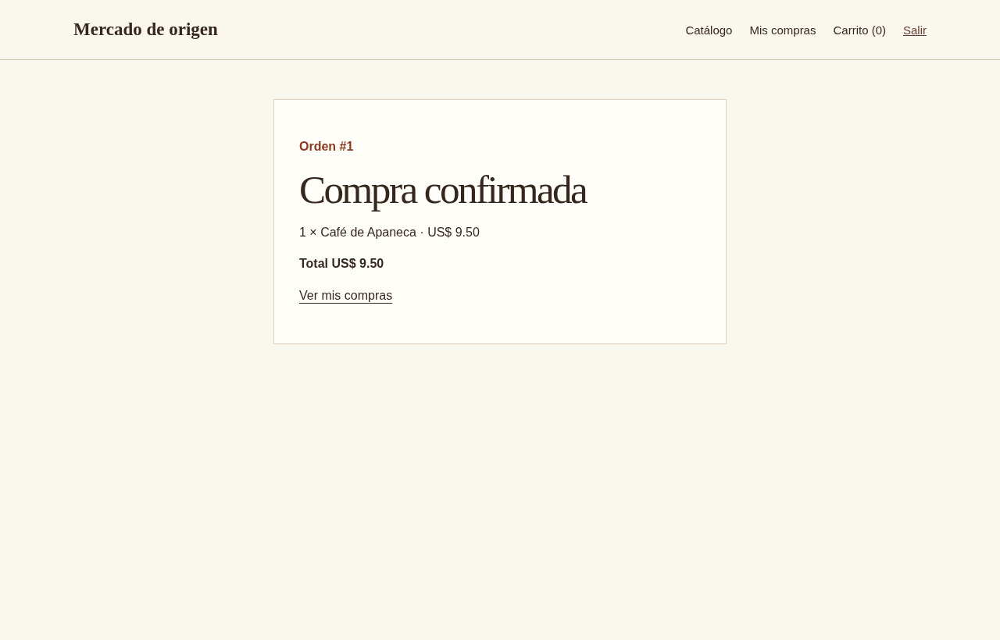
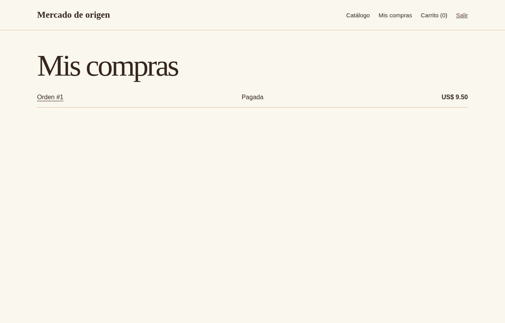

# Mercado de origen

Frontend de la tienda de productos salvadoreños para el ejercicio de Web Vitals y mutaciones asíncronas de KODIGO Academy. Está construido con Next.js 16, App Router y TypeScript. Consume la [API Laravel de la actividad anterior](https://github.com/karenfrineth/tienda-api-laravel).

## Instalación

1. Inicia la API Laravel y MySQL siguiendo su README. Ejecuta sus migraciones y el seeder para cargar el catálogo. Comprueba que puedes abrir su Swagger UI en `http://127.0.0.1:8000/api/documentation`.
2. Con Node.js 22.12 o superior y npm instalados, ejecuta `npm ci`. Copia `.env.example` a `.env.local`.
3. Ajusta las siguientes variables:

   | Variable | Valor o uso |
   |---|---|
   | BASE_URL | URL de la API accesible **desde el servidor Next**, con el sufijo `/api`. El valor local es `http://127.0.0.1:8000/api`. |
   | APP_ORIGIN | Origen público exacto al que entra el navegador, sin barra final. En desarrollo: `http://localhost:3000`. En Codespaces o detrás de un proxy, usa el origen HTTPS del puerto del frontend. |
   | COOKIE_SECURE | `false` para HTTP local. Usa `true` en un despliegue HTTPS. |
   | NEXT_PUBLIC_STRIPE_PUBLISHABLE_KEY | Clave publicable de prueba de la misma cuenta de Stripe que usa Laravel. Se incorpora en la compilación. Las claves secretas de Stripe y de firma del webhook se configuran exclusivamente en Laravel. |

4. Ejecuta `npm run dev` y abre `http://localhost:3000`. Para reproducir el modo de producción, usa `npm run build` y después `npm start`. Ejecuta `npm run check` para comprobar los tipos.

## Rutas y contrato

| Pantalla | Ruta de Next | Operación de Laravel |
|---|---|---|
| Catálogo público | `/` | GET /products |
| Ficha del producto | `/catalogo/[id]` | GET /products/{product} |
| Registro | `/registro` | POST /register desde una Server Action |
| Acceso | `/acceso` | POST /login desde el Route Handler POST /sesion |
| Carrito y pago | `/checkout` | POST /orders y POST /orders/{id}/payment desde una Server Action |
| Resultado de la compra | `/compras/[id]` | GET /orders/{id}; reconsulta del estado tras la confirmación |
| Historial privado | `/historial` | GET /orders con el token del usuario |
| Notificación de Stripe | En Laravel | POST /stripe/webhook con firma del proveedor |

Los Server Components obtienen los productos y las órdenes. El Route Handler recibe las credenciales por POST, verifica el origen y guarda el JWT en una cookie HttpOnly con SameSite=Lax y la duración emitida por Laravel. Las operaciones privadas agregan el token a la petición en el servidor. El formulario de registro, la creación de la orden, la preparación del pago y el cierre de sesión usan Server Actions.

## Recorrido de prueba con Stripe en modo de prueba

1. Abre el catálogo, visita una ficha y agrega un producto al carrito. En el carrito puedes quitar líneas y volver al catálogo. El contenido del carrito se conserva en el navegador.
2. Registra un usuario e inicia sesión. En el checkout pulsa **Continuar al pago**. La API recibe la referencia del carrito y pares de producto/cantidad, calcula el precio y genera o recupera el PaymentIntent. La referencia se conserva al reintentar el mismo carrito.
3. Para probar con Stripe, configura el listener del webhook como indica el README del backend. Al confirmar, el Payment Element transmite los datos directamente a Stripe. Puedes usar la tarjeta de prueba 4242 4242 4242 4242, una fecha futura y un CVC de prueba en modo test.
4. La página del recibo consulta la orden del usuario. Muestra **Compra confirmada** cuando Laravel registra el pago. Si el webhook tarda, la pantalla muestra un estado pendiente y permite consultar otra vez. Después visita **Mis compras**. El carrito se limpia cuando coincide con la referencia pagada.

## Rendimiento y errores

- El catálogo y el historial usan Suspense. Hay estados de carga en `app/loading.tsx` y `app/checkout/loading.tsx`, y un límite de errores con opción de reintentar en `app/error.tsx`.
- Las fotografías locales se sirven mediante next/image con dimensiones reservadas y tamaños adaptativos. La primera imagen del catálogo tiene prioridad de carga.
- Las lecturas de datos del backend usan `cache: no-store`. Tras crear la orden se invalida el historial con `revalidatePath`; al verificar el pago se invalidan también las rutas de recibo e historial. La sesión y las órdenes permanecen en el servidor, salvo la información de pantalla y el secreto de cliente necesario para Stripe.js.
- Los errores de autenticación, validación y conexión tienen mensajes en la interfaz. Los botones de mutación se desactivan mientras se procesa la petición.

## Evidencia

Las capturas están en [docs/evidencia](docs/evidencia). La prueba recorrió la interfaz de producción con la API Laravel y MySQL locales. La parte externa de Stripe se simuló en el entorno de prueba, incluido el widget, y se entregó un webhook firmado localmente a Laravel. El proyecto distribuido utiliza Stripe.js y el Payment Element del proveedor. Para reproducir una operación en Stripe test se necesitan las claves de la cuenta y un webhook configurado.

El informe original está en [lighthouse.html](docs/evidencia/lighthouse.html). Descárgalo y ábrelo en un navegador para ver los detalles. La medición de laboratorio corresponde a la portada en modo de producción y con perfil móvil. El rendimiento en un despliegue público dependerá del dispositivo, la red y el alojamiento.

[Créditos de las fotografías](CREDITOS.md)
